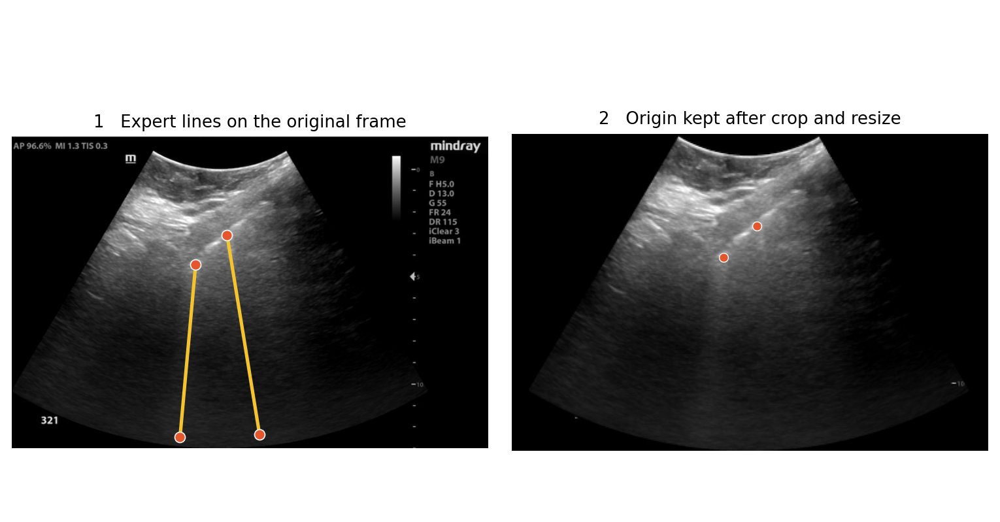

# Deep Learning for Detection and Localization of B-Lines in Lung Ultrasound
This repository contains all code to support the paper:  

***"Deep Learning for Detection and Localization of B-Lines in Lung Ultrasound"***  

Published in IEEE Journal of Biomedical and Health Informatics. 

[[`arXiv`](https://arxiv.org/abs/2302.07844)] [[`JBHI`](https://ieeexplore.ieee.org/abstract/document/10143623)] [[`Supplementary material`](https://github.com/RTLucassen/B-line_detection/tree/main/supplementary_material_paper)]


<div align="center">
   
  &nbsp;&nbsp;&nbsp;&nbsp;&nbsp;&nbsp;&nbsp;&nbsp;
  
</div>
&nbsp;
<div align="center">
   
  &nbsp;&nbsp;&nbsp;&nbsp;&nbsp;&nbsp;&nbsp;&nbsp;
  
</div>

## Data and Network Parameters
As part of this work, we curated the ***"Boston Emergency Department Lung UltraSound (BEDLUS)"*** dataset.
This dataset comprises 1,419 videos from 113 patients, along with expert annotations.
All videos are labeled as positive or negative for the presence of B-lines. For the positive videos, a total of 15,755 B-lines are annotated on 10,371 frames.

The BEDLUS dataset and network parameter files for the trained models are available at [Harvard Dataverse](https://doi.org/10.7910/DVN/GLCZRB).

## Project Setup
1. Install all required libraries (Python version 3.7): 
```
pip install -r requirements.txt
```
2. Create the project folder structure after specifying the root folder in `config.py`: 
```
python utils/config.py
```
3. After requesting access, download and unzip the dataset (`data.zip`) and network parameter files (`networks_clip-level.zip`, `networks_frame-level.zip`, `networks_pixel-level.zip`).
3. Copy all contents from `data/LUS_videos` to `project_root/raw`.
The raw-folder should contain a subfolder for each patient (e.g. Case-001) with LUS videos as mp4-files inside.
4. Copy all pkl-files with dataset information `supplementary_files/*.pkl` (in this repository) to `project_root/intermediate/data/info`.
5. Copy all csv-files with annotation information `supplementary_files/*.csv` (in this repository) to `project_root/intermediate/data/annotations`.
6. Copy all contents (or only the network parameter files for the models of interest) from `clip-level`, `frame-level`, `pixel-level` to `project_root/intermediate/models`.

## Data Preparation
Extract and preprocess the frames from the lung ultrasound videos:
```
python data_preparation/5_get_processed_frames.py
```
A new folder `intermediate/data/images/processed_frames` is created with inside all processed frames.
All other python files in the `data_preparation` folder were used to extract the processing information (e.g. for cropping and rescaling),
which is already available in the supplementary pkl-files.

## Dataset Generation
From the preprocessed frames, datasets with labels or annotations can be created for training deep neural networks at the level of multi-frame clips, single frames, and individual pixels (i.e., segmentation). 
The dataset split is already provided in one of the supplementary files.

Each expert annotation is a line. Training uses only the upper end of that line, the B-line origin at the pleura, drawn as a disk 4 mm across on the processed frame. The example below is Case-001, clip 3, frame 0 from `B-line_expert_annotation.csv`.

<div align="center">
  
</div>

1. Specify the dataset type in `2_create_dataset.py`: 
    - `frames = 1` for frame-level and pixel-level
    - `frames = 16` for clip-level
2. Create the dataset:
```
python dataset_generation/2_create_dataset.py
```
3. Specify the labelset type in `3_create_dataset.py`:
    - `task = 'segmentation'` with `folder = 'frames_1'` for the pixel-level
    - `task = 'classification'` with `folder = 'frames_1'` for the frame-level
    - `task = 'classification'` with `folder = 'frames_16'` for the clip-level
4. Create the labelset:
```
python dataset_generation/3_create_labelset.py
```

## Network Training & Evaluation
Network training details can be configured for a single training run in `single_training_run.py`, which is inside the `network_training` folder. Alternatively, the training details can be specified in a csv-file (e.g., see `network_training/example_training_schedule.csv`) when running multiple consecutive experiments using `scheduled_training_runs.py` in the `network_training` folder.

The evaluation folder contains all code that was used for the evaluation, separated in subfolders for each level.

### Preparing the Lahey Training Set
Run these three scripts in order. `--project-root` is the training project, and `--processed-root` is the output of `scripts_dk/1_preprocess_lahey.py`. Pass `--all-raters` to use every annotated clip, or `--rater` and a rater name instead. Each patient stays in one split.

Create the train, validation, and test splits:
```
python scripts_dk/5_create_splits.py \
    --processed-root /path/to/processed \
    --project-root /path/to/lahey_training \
    --all-raters
```

Copy the frames into positive and negative folders. A frame is positive when its mask contains a B-line origin:
```
python scripts_dk/6_create_dataset.py \
    --processed-root /path/to/processed \
    --project-root /path/to/lahey_training \
    --all-raters
```

Write the segmentation labels and the CSV that training reads:
```
python scripts_dk/7_create_labelset.py \
    --processed-root /path/to/processed \
    --project-root /path/to/lahey_training \
    --all-raters
```

### Running Scheduled Training
Each row of the spreadsheet is one model and one validation fold. `scripts_dk/8_scheduled_training_runs.py` trains every row whose `finished` cell is false and writes the networks to `{project-root}/intermediate/models/{ID}_{name}_{val_fold}/`:
```
python scripts_dk/8_scheduled_training_runs.py \
    --schedule /path/to/training_runs.xlsx \
    --project-root /path/to/lahey_training
```

### Creating an Ensemble Folder
`scripts_dk/9_create_ensemble_folder.py` combines the trained fold models of one architecture into a single ensemble folder. Pass the model folders in the order they should be numbered:
```
python scripts_dk/9_create_ensemble_folder.py \
    --models 0101_resnet18_unet_0 0102_resnet18_unet_1 0103_resnet18_unet_2 0104_resnet18_unet_3 0105_resnet18_unet_4 \
    --ensemble-name ensemble_resnet18_unet \
    --project-root /path/to/lahey_training
```
The script reads `{project-root}/intermediate/models/{model}/model.pth` and `experiment_settings.pkl`, copies them to `{project-root}/intermediate/models/{ensemble-name}/` as `model_0.pth`, `model_1.pth`, and so on, and writes `model_origins.csv`. It stops if the ensemble folder already exists or if the selected models were trained with different labels. Use `--models-dir` to point at a models directory other than `{project-root}/intermediate/models`.

### Running Inference for One Ensemble
`scripts_dk/2_run_inference.py` loads every `model_*.pth` in the ensemble folder, averages the foreground probabilities, and writes one mask per frame. Pass `--ensemble` and set `--model-dir` to that folder:
```
python scripts_dk/2_run_inference.py \
    --ensemble \
    --model-dir /path/to/lahey_training/intermediate/models/ensemble_resnet18_unet \
    --images-root /path/to/processed/images \
    --predictions-root /path/to/data/predictions \
    --split-file /path/to/lahey_training/intermediate/data/info/dataset_split_dictionary.json \
    --split test
```
Masks are written to `{predictions-root}/ensemble_resnet18_unet/{clip}/`. `--split test` limits the run to the held-out clips. Omit `--split-file` to run on every clip. Without `--ensemble`, `--model-dir` is the parent of the experiment folders and every subdirectory is run.

### Writing Model Summaries
`scripts_dk/10_model_information.py` writes a torchinfo architecture summary next to each checkpoint in the selected folders. Pass one folder, several folders, or `all` for every folder in the models directory:
```
python scripts_dk/10_model_information.py \
    --models ensemble_resnet18_unet \
    --project-root /path/to/lahey_training
```
For each `model*.pth` it writes `model_N_summary.txt` in that folder. The input size defaults to `256 384`; use `--output-shape HEIGHT WIDTH` if your frames differ. `--models-dir` works here too.

### Evaluating Predictions
`scripts_dk/3_evaluate.py` compares every prediction folder under `--predictions-root` with each rater's masks. Each folder gets one Excel file in `--results-root` with a summary sheet, a per-clip sheet, and one frame-level sheet per rater. `--split-file` and `--split test` restrict scoring to the held-out clips:
```
python scripts_dk/3_evaluate.py \
    --processed-root /path/to/data \
    --masks-root /path/to/data/processed/masks \
    --predictions-root /path/to/lahey_training/predictions \
    --meta-root /path/to/data/processed/meta \
    --results-root /path/to/lahey_training/evaluation \
    --split-file /path/to/lahey_training/intermediate/data/info/dataset_split_dictionary.json \
    --split test
```
Only `--processed-root` is required; each other path defaults to a subfolder of it (`processed/masks`, `predictions`, `processed/meta`, and `evaluation`). Set the other paths only when your layout differs.

### Making Side-by-Side Movies
`scripts_dk/4_viz.py` writes one MP4 per clip and rater. The left panel shows the rater's mask in green and the right panel shows the predicted mask in orange. Pass `--split-file` and `--split test` to make movies only for the held-out clips:
```
python scripts_dk/4_viz.py \
    --images-root /path/to/data/processed/images \
    --masks-root /path/to/data/processed/masks \
    --predictions-root /path/to/lahey_training/predictions \
    --movies-root /path/to/lahey_training/viz \
    --split-file /path/to/lahey_training/intermediate/data/info/dataset_split_dictionary.json \
    --split test
```
Movies are written to `{movies-root}/{model}/{rater}/{stem}.mp4`. To make one movie while checking the setup, add `--test --model ensemble_resnet18_unet --rater andrew --stem <clip>`.

## Citing
If you found our work useful in your research, please consider citing our paper:
```
@article{lucassen2023deep,
  title={Deep Learning for Detection and Localization of B-Lines in Lung Ultrasound},
  author={Lucassen, Ruben T and Jafari, Mohammad H and Duggan, Nicole M and Jowkar, Nick and Mehrtash, Alireza and Fischetti, Chanel and Bernier, Denie and Prentice, Kira and Duhaime, Erik P and Jin, Mike and others},
  journal={IEEE Journal of Biomedical and Health Informatics},
  year={2023},
  publisher={IEEE}
}
```
